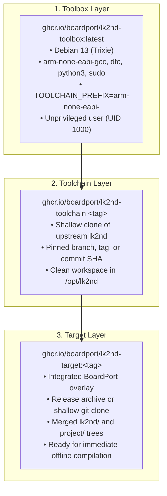

# 🏛️ Architecture and System Design: BoardPort — lk2nd Builder

This document outlines the system architecture, decomposition model, and build orchestration strategy
of the **BoardPort — lk2nd Builder** project.

---

## 🎯 Purpose and System Philosophy

**lk2nd Builder** acts as the root orchestrator project unifying decoupled ecosystem components
to provide deterministic, reproducible builds of secondary bootloaders lk2nd and lk1st:

1. **Out-of-Tree Architecture:**
   Upstream source code from `msm8916-mainline/lk2nd` is not stored in the repository. Instead, it is fetched
   strictly during OCI container builds according to a pinned tag (`LK2ND_REF`) or exact commit SHA (`LK2ND_COMMIT`).
2. **Modular Submodule Decomposition:**
   - [`docker/`](https://github.com/boardport/lk2nd-docker) — isolated containerization layers (Toolbox, Toolchain, Target).
   - [`overlay/`](https://github.com/boardport/lk2nd-overlay) — out-of-tree hardware overlay (DTS files, board profiles, build rules).
3. **Unified Automation Facade:**
   The master `Makefile` and `.make/*.mk` modules provide a unified CLI interface (`make list`, `make lk2nd-build`).

---

## 📁 Repository Structure

```text
lk2nd-builder/
├── .editorconfig                   # Unified formatting standards for editors
├── .markdownlint-cli2.jsonc        # Markdown linter rules and exclusions
├── .gitignore                      # Git exclusions (build caches, dumps, .env)
├── .gitattributes                  # Line ending normalization and export-ignore rules
├── .aiignore                       # Context exclusion rules for AI assistants
├── LICENSE                         # MIT License
├── Makefile                        # Master automation entry point
├── AGENTS.md / AGENTS_RU.md        # Operational guidelines for autonomous AI agents
├── README.md / README_RU.md        # Public overview and documentation index
│
├── docs/                           # Technical documentation (GitHub Pages & Astro)
│   ├── overview.en.md / .ru.md     # Project overview and hardware targets
│   ├── architecture.en.md / .ru.md # System architecture and container model
│   └── development.en.md / .ru.md  # Make workflow guide and local development
│
├── .github/                        # Community templates and CI/CD pipelines
│   ├── workflows/                  # GitHub Actions automation workflows
│   │   ├── build_toolbox.yml       # Base Toolbox image build pipeline
│   │   ├── build_toolchain.yml     # Toolchain image build pipeline with upstream lk2nd
│   │   ├── release_target.yml      # Compile and publish bootloader images to GitHub Releases
│   │   └── markdownlint.yml        # Automated markdown documentation verification
│   ├── ISSUE_TEMPLATE/             # Issue templates (bug reports, feature requests)
│   └── PULL_REQUEST_TEMPLATE/      # Pull request description templates
│
├── .make/                          # Modular Make workflow scripts
│   └── lk2nd_docker.mk             # OCI image management and build commands
│
├── docker/                         # Git submodule: container recipes & toolchains
└── overlay/                        # Git submodule: hardware targets & device trees
```

---

## 🧱 Layered Containerization and Build Model

The build pipeline is organized into a 3-tier OCI container hierarchy:



---

## 🏷️ Version Compatibility Matrix

The `lk2nd-overlay` and container recipes are audited and compatible with upstream lk2nd releases:

| lk2nd Version | Overlay Support | Base Toolchain | Overlay Release Archive |
| :--- | :--- | :--- | :--- |
| **23.1** | Full (100%) | `arm-none-eabi-` | `lk2nd-overlay-23.1.tar.gz` |
| **23.0** | Full (100%) | `arm-none-eabi-` | `lk2nd-overlay-23.0.tar.gz` |
| **22.0** | Full (100%) | `arm-none-eabi-` | `lk2nd-overlay-22.0.tar.gz` |
| **21.0** | Full (100%) | `arm-none-eabi-` | `lk2nd-overlay-21.0.tar.gz` |
| **20.0** | Full (100%) | `arm-none-eabi-` | `lk2nd-overlay-20.0.tar.gz` |
| **19.0** | Full (100%) | `arm-none-eabi-` | `lk2nd-overlay-19.0.tar.gz` |
| **18.1** | Full (100%) | `arm-none-eabi-` | `lk2nd-overlay-18.1.tar.gz` |
| **18.0** | Full (100%) | `arm-none-eabi-` | `lk2nd-overlay-18.0.tar.gz` |
| **17.0** | Full (100%) | `arm-none-eabi-` | `lk2nd-overlay-17.0.tar.gz` |
| **main** | Development | `arm-none-eabi-` | Git clone fallback |
