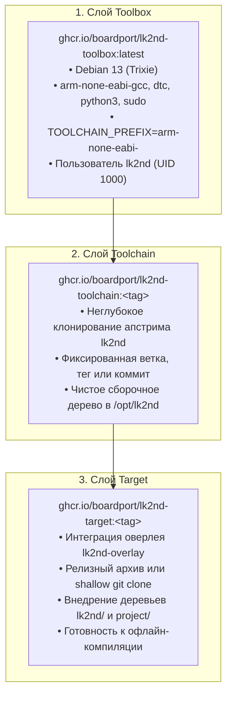

# 🏛️ Архитектура и системный дизайн: BoardPort — lk2nd Builder

Настоящий документ описывает архитектуру системы, модель декомпозиции и стратегию оркестрации
в рамках проекта **BoardPort — lk2nd Builder**.

---

## 🎯 Назначение и концепция системы

**lk2nd Builder** представляет собой корневой проект-оркестратор (Root Orchestrator), объединяющий изолированные компоненты
экосистемы для воспроизводимой сборки вторичных загрузчиков lk2nd и lk1st:

1. **Изоляция исходников апстрима (Out-of-Tree Architecture):**
   Исходный код апстрима `msm8916-mainline/lk2nd` не хранится в git-репозитории проекта. Он извлекается исключительно
   на этапе сборки OCI-контейнеров по точному тегу (`LK2ND_REF`) или коммиту (`LK2ND_COMMIT`).
2. **Модульная декомпозиция на независимые субмодули:**
   - [`docker/`](https://github.com/boardport/lk2nd-docker) — изолированные слои контейнеризации (Toolbox, Toolchain, Target).
   - [`overlay/`](https://github.com/boardport/lk2nd-overlay) — внешний аппаратно-зависимый оверлей (DTS, профили плат, правила сборки).
3. **Единый фасад автоматизации:**
   Корневой `Makefile` и модули `.make/*.mk` предоставляют унифицированный CLI-интерфейс (`make list`, `make lk2nd-build`).

---

## 📁 Структура корневого репозитория

```text
lk2nd-builder/
├── .editorconfig                   # Единые стандарты форматирования редакторов
├── .markdownlint-cli2.jsonc        # Правила и исключения линтера Markdown
├── .gitignore                      # Исключения Git (кэши сборки, дампы, .env)
├── .gitattributes                  # Правила нормализации и export-ignore
├── .aiignore                       # Исключения контекста для AI-ассистентов
├── LICENSE                         # Лицензия MIT
├── Makefile                        # Главный входной фасад автоматизации
├── AGENTS.md / AGENTS_RU.md        # Регламент для автономных AI-агентов
├── README.md / README_RU.md        # Публичный обзор и индекс документации
│
├── docs/                           # Техническая документация (GitHub Pages & Astro)
│   ├── overview.en.md / .ru.md     # Обзор проекта и аппаратные платформы
│   ├── architecture.en.md / .ru.md # Архитектура системы и модель контейнеров
│   └── development.en.md / .ru.md  # Руководство по Make и локальной разработке
│
├── .github/                        # Шаблоны сообщества и CI/CD
│   ├── workflows/                  # Конвейеры автоматизации GitHub Actions
│   │   ├── build_toolbox.yml       # Сборка базового слоя Toolbox
│   │   ├── build_toolchain.yml     # Сборка слоя Toolchain с апстримом lk2nd
│   │   ├── release_target.yml      # Сборка и публикация образов загрузчика в GitHub Releases
│   │   └── markdownlint.yml        # Автоматическая проверка документации
│   ├── ISSUE_TEMPLATE/             # Шаблоны обращений (баг-репорты, фичи)
│   └── PULL_REQUEST_TEMPLATE/      # Шаблоны описания PR
│
├── .make/                          # Модульные сценарии Make
│   └── lk2nd_docker.mk             # Команды управления OCI-образами и сборкой
│
├── docker/                         # Git submodule: рецепты контейнеров и тулчейны
└── overlay/                        # Git submodule: платформенные таргеты и DTS
```

---

## 🧱 Слоистая модель контейнеризации и сборки

Сборочный конвейер структурирован в виде 3-уровневой OCI-иерархии:



---

## 🏷️ Матрица совместимости версий

Оверлей `lk2nd-overlay` и сборочные рецепты протестированы и совместимы со следующими версиями апстрима:

| Версия lk2nd | Поддержка оверлея | Базовый тулчейн | Релизный архив оверлея |
| :--- | :--- | :--- | :--- |
| **23.1** | Полная (100%) | `arm-none-eabi-` | `lk2nd-overlay-23.1.tar.gz` |
| **23.0** | Полная (100%) | `arm-none-eabi-` | `lk2nd-overlay-23.0.tar.gz` |
| **22.0** | Полная (100%) | `arm-none-eabi-` | `lk2nd-overlay-22.0.tar.gz` |
| **21.0** | Полная (100%) | `arm-none-eabi-` | `lk2nd-overlay-21.0.tar.gz` |
| **20.0** | Полная (100%) | `arm-none-eabi-` | `lk2nd-overlay-20.0.tar.gz` |
| **19.0** | Полная (100%) | `arm-none-eabi-` | `lk2nd-overlay-19.0.tar.gz` |
| **18.1** | Полная (100%) | `arm-none-eabi-` | `lk2nd-overlay-18.1.tar.gz` |
| **18.0** | Полная (100%) | `arm-none-eabi-` | `lk2nd-overlay-18.0.tar.gz` |
| **17.0** | Полная (100%) | `arm-none-eabi-` | `lk2nd-overlay-17.0.tar.gz` |
| **main** | Ветка разработки | `arm-none-eabi-` | Git clone fallback |
